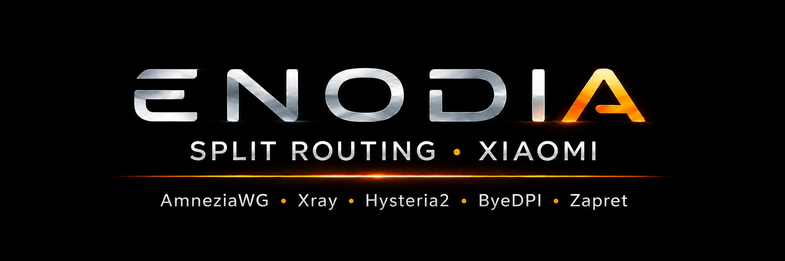
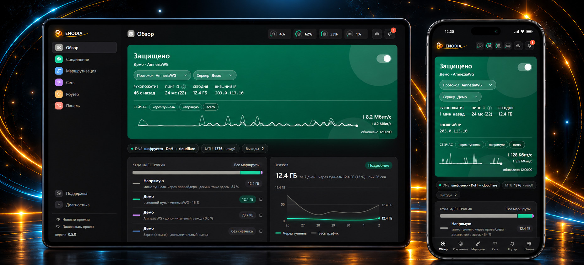

### [Русский](README.md) | English

Enodia is an open-source project for Xiaomi routers on stock firmware (BE3600, BE6500, BE7000, BE10000, AX3600),
without OpenWrt. Blocked sites go through your VPN server (AmneziaWG, Xray, Hysteria2, WARP) or open without a server
(ByeDPI, Zapret), all other traffic goes direct. Everything is configured in a web panel on the router itself.

### [Download](https://github.com/Axel173/enodia/releases) | [Telegram](https://t.me/+tfMLMVKG03FhMGYy) | [Support the author](#donate)

## Features

- Installation from a computer: the wizard opens SSH on the router and installs the panel, the rest
  is done in the browser.
- Split routing by domains, subnets, geo categories and rule groups, separately for devices and
  Wi-Fi networks.
- Several VPN protocols and up to six additional exits through other servers.
- Subscriptions: Xray, Hysteria2, AmneziaWG and WireGuard servers from one link (3x-ui included), updated on a
  schedule. Any saved server can be handed back by the panel — as a link, a QR code or a file.
- An Amnezia Premium key goes where a subscription link goes: the router takes the configs of the countries you pick
  from Amnezia by itself (AmneziaWG or VLESS) and holds one place of the subscription for all of them. A new key takes
  its place only once it carries; a server that went silent is moved to the reserve, and the watchdog takes it a new key in
  the background.
- Bypassing blocks without your own server: ByeDPI and Zapret.
  On AX3600 stock firmware 1.1.21, the Zapret component includes a kernel support package;
  compatibility is checked before loading modules. Other firmware builds and BE3600 need separate validation.
- A server whose address your ISP blocked: the panel says so («address blocked»), not «not responding», and sends it
  over a road — another exit, for example your own Cloudflare WARP, which the router gets by itself with one button; if
  the ISP starts cutting WARP's port, the watchdog picks another one by itself.
- Home access: the router works as an AmneziaWG server, a phone connects with a QR code.
- Encrypted DNS (DoH, DoT, DoQ and DoH3 over QUIC, and ODoH — through a relay: the resolver never learns whose questions they are), ad blocking, panel login with two-factor authentication.
- Watchdog: restarts the tunnel, switches to a backup server, emails you about failures.
- Access schedules for children and consoles: when a device may go online, a daily minute limit and «limited»
  windows — the chosen categories (social networks, messengers, video, games, any pool of the geo catalogue, own sites and
  addresses) are closed, the rest works; or the other way round — only the allowed is open; safe search for Google, Yandex,
  Bing, DuckDuckGo and YouTube.
- Your own scheduled tasks: a script, a file or a command — on a cron schedule, at boot or by a button, with a
  run history and an email on failure; the router's whole crontab is visible and editable in the panel.
- Traffic for today, the week, the month and the year: through the tunnel and direct, by exit and by device.
- Updates from the panel as a signed package from GitHub.
- Protocols or the whole system can live on a USB stick.
- The panel is in Russian and English, with light and dark themes.

## Routers

The project has been run and worked on Xiaomi BE3600, BE6500, BE7000, BE10000, BE10000 PRO and AX3600
routers with stock firmware. The setup wizard opens root SSH access by itself with the built-in
[xmir-patcher](https://github.com/Axel173/xmir-patcher). If the firmware keeps a backup copy of its settings (on the BE6500
it takes almost 4 MB of flash), the wizard and the panel offer to turn that copy off — and name the price first.

## Protocols

## Installation

1. Download `enodia-setup-<version>.zip` from the
   [Releases](https://github.com/Axel173/enodia/releases) page and unpack it.
2. Run `enodia-setup.bat` (Windows), `enodia-setup.command` (macOS) or `./enodia-setup.sh` (Linux).
3. Go through the setup wizard in the browser.
4. Open the panel: `http://192.168.31.1:8088` (your router's IP, port 8088). The login is `admin`, the password is the
   one you set in the wizard.

No need to install Python: if it's missing, the launcher downloads it. Details are on the
[documentation site](https://axel173.github.io/enodia/en/); questions go to [Telegram](https://t.me/+tfMLMVKG03FhMGYy).

## Projects used

- [AmneziaWG](https://github.com/amnezia-vpn/amneziawg-go), [amneziawg-tools](https://github.com/amnezia-vpn/amneziawg-tools)
- [Xray-core](https://github.com/XTLS/Xray-core)
- [Hysteria](https://github.com/apernet/hysteria)
- [ByeDPI](https://github.com/hufrea/byedpi)
- [zapret](https://github.com/bol-van/zapret)
- [hev-socks5-tunnel](https://github.com/heiher/hev-socks5-tunnel)
- [https_dns_proxy](https://github.com/aarond10/https_dns_proxy)
- [xmir-patcher](https://github.com/openwrt-xiaomi/xmir-patcher)
- [amneziawg-be7000](https://github.com/alexandershalin/amneziawg-be7000) — AmneziaWG installation script (`awg_setup.sh`)
- lists: [opencck / iplist](https://iplist.opencck.org) (based on [rekryt/iplist](https://github.com/rekryt/iplist)),
  [ITDog allow-domains](https://github.com/itdoginfo/allow-domains)

Thanks to the [@xiaomi_be7000](https://t.me/xiaomi_be7000) community for their experience with these routers.

## License

The project code is [GPL-3.0](LICENSE). The protocol programs in `bin/` are built from the sources of the projects above and
are distributed under their own licenses.

## Support the author

The project is **free and open-source**, and there's a lot of manual work behind it: debugging on
live hardware, maintaining the lists and scripts, documentation.

If it saved you **time and nerves** or was simply useful — here's how to say thanks:

**One-time or recurring donation via Telegram:**
- 💬 **Telegram (Tribute)** — [web.tribute.tg/d/LtA](https://web.tribute.tg/d/LtA) (by card)
- 💎 **Telegram (Tribute, crypto)** — [t.me/tribute](https://t.me/tribute/app?startapp=dLtA) (crypto, right inside Telegram)

**With cryptocurrency** (several networks to choose from — the donor picks the convenient one):
<!-- One address per network, the network's tokens share it:
       ETH + USDT-ERC20      → one Ethereum address (0x…)
       TRX + USDT-TRC20      → one TRON address (T…)
       Toncoin + USDT-TON    → one TON address (UQ…)
     Cheap for the donor: TON and USDT-TON (~a cent), SOL (fractions of a cent), TRX. Pricier: BTC, ETH, USDT-ERC20. Addresses verified by checksum. -->
- ₿ **Bitcoin (BTC)** — `bc1q5wdv30gdnsc95dkju6zkenjjcsnfs0z77wxhsh`
- Ξ **Ethereum (ETH)** — `0x6558410D16A2937c7B7eF7E447013ddEadf11e4e`
- ₮ **USDT** — **TON** network — `UQDkGR4JuzMN1cUg_5ehYf5RFRSbvs7ynjeOdPCyC72F8r3a`
- ₮ **USDT** — **TRC-20** (TRON) network — `TKPAFNRJUx6zcYTeCrAEBjFoWhuPUDyBG8`
- ₮ **USDT** — **ERC-20** (Ethereum) network — `0x6558410D16A2937c7B7eF7E447013ddEadf11e4e`
- 💎 **Toncoin (TON)** — `UQDkGR4JuzMN1cUg_5ehYf5RFRSbvs7ynjeOdPCyC72F8r3a`
- 🔺 **TRON (TRX)** — `TKPAFNRJUx6zcYTeCrAEBjFoWhuPUDyBG8`
- ◎ **Solana (SOL)** — `Eq48vnUcJn8yxmAtmyZJ4wmGW3TJaMhRdZkRJi1VULYx`

**Getting a VPS for the project? Use a referral link:**
you need a server anyway (see [Protocols](#protocols)) — if you sign up through a
link below, the author gets a small bonus, **and the price stays the same for you** (with VDSina — even at a discount).
- 🖥️ **[MegaHost](https://megahost.kz/?from=16375)** (referral link) — VPS and hosting in Kazakhstan (own data centers, a registrar since 2009)
- 🖥️ **[JustHost](https://justhost.asia/?ref=232764)** (referral link) — VPS in many locations worldwide (you can pick the server's country)
- 🖥️ **[VDSina](https://www.vdsina.com/?partner=x8rv7m67wj)** (referral link) — affordable VPS with hourly billing; this link gives **you a 10% discount**. _(No discount but a bigger bonus to the author — [alternative link](https://www.vdsina.com/?partner=7i8wuiy8x5).)_
- 🖥️ **[HostVDS](https://hostvds.com/?affiliate_uuid=f47d06d6-4bbf-420a-844b-4bee4e98886a)** (referral link) — affordable NVMe VPS, locations worldwide

Thank you!
